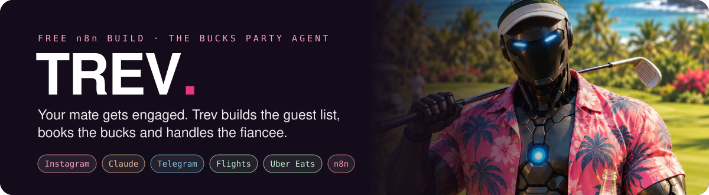
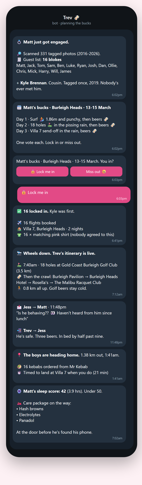
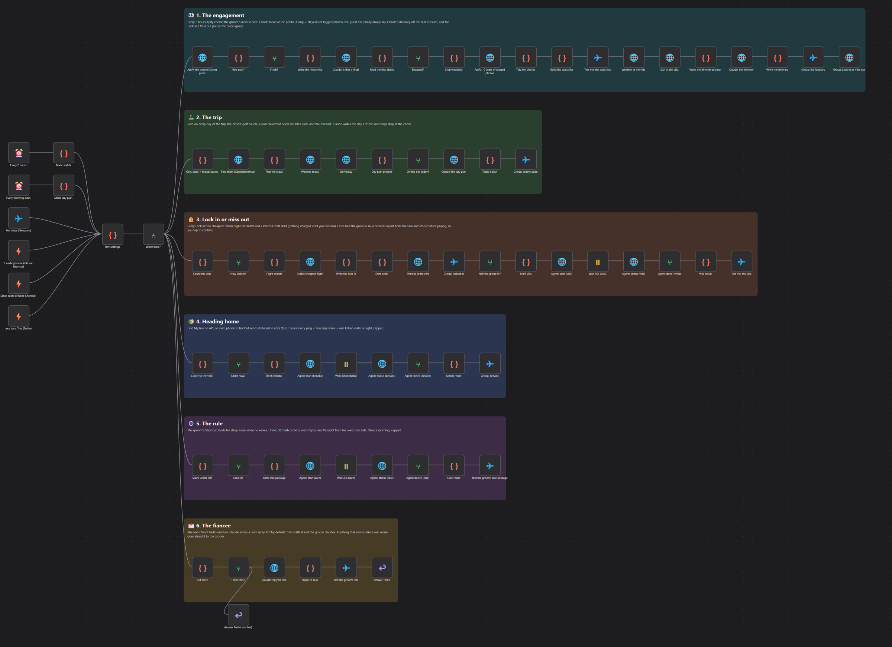

<p align="center">
  
</p>

<h3 align="center">The most unhinged bachelor party automation ever. Free.</h3>

<p align="center">
  <a href="https://github.com/aaronparton2-sketch/trev/archive/refs/heads/main.zip"></a>
</p>
<p align="center"><sub>No GitHub account. No coding. Your AI does the setup with you.</sub></p>

---

## 👋 New to GitHub? You only need one of these

**This page is just where Trev lives.** You don't need to understand any of it. Pick a way in:

<table>
<tr>
<td width="50%" valign="top">

### ⚡ The fast way
Copy this and paste it into **[Claude](https://claude.ai)** or **[ChatGPT](https://chatgpt.com)**:

```text
Set this up for me: https://github.com/aaronparton2-sketch/trev
```

It reads this page and walks you through it, one click at a time.

</td>
<td width="50%" valign="top">

### 📦 The download way
1. Click the pink **Download Trev** button above (or the green **Code** button, then **Download ZIP**).
2. Drag the zip into Claude or ChatGPT.
3. Paste this:

```text
I've downloaded Trev, a free n8n automation. I have never used n8n or GitHub and I can't code. Read SETUP-GUIDE.md in this zip, then set up the DEMO with me. Give me one step at a time, tell me exactly what to click, and wait for me to say done. If I get stuck, ask me for a screenshot.
```

</td>
</tr>
</table>

Start with the **demo**. One click runs the whole bucks on your phone, costs about 2 cents, and books nothing.

---

## 📱 What Trev sends you

<p align="center">
  
</p>

---

## 🍻 The bucks, step by step

| | Trev... | In plain English |
|:-:|---|---|
| 💍 | **spots the ring** | Trev watches the groom's Instagram. Claude looks at every new photo, and the second there's a ring, it's on. |
| 🔎 | **builds the guest list** | Ten years of photos the groom's tagged in. Whoever shows up most makes the list, and family's always in. That's how cousin Kyle got on it. |
| 🗓️ | **writes the itinerary** | Surf, golf, beers and more beers, planned around the real surf and weather forecast. |
| 🔒 | **makes everyone choose** | A poll in the group chat: Lock me in, or Miss out. One vote each. |
| ✈️ | **books the boys** | Every yes gets the cheapest flight found, a matching pink shirt, and once half the group's in, the villa. |
| ⛳ | **runs the trip** | 18 holes every morning at the closest course, then a pub crawl that never walks back on itself. |
| 📩 | **handles the fiancee** | She texts, Trev replies: "He's safe. Two beers. In bed by ten." |
| 🥙 | **feeds the boys** | The second everyone's phones start heading home, 16 kebabs get ordered to meet you at the villa. |
| ⌚ | **checks on the groom** | Sleep score under 50? Hash browns, electrolytes and Panadol at the door before he's found his phone. |

---

## 🧠 How Trev does the "impossible" bits

Most of these apps don't let automations in. Here's the honest workaround for each.

| The problem | The workaround |
|---|---|
| **Instagram has no API for other people's posts** | [Apify](https://apify.com) reads the groom's public posts and the photos he's tagged in. It only sees what's public. |
| **"Is that a ring?" can't be a keyword** | Claude looks at the actual photo, so a ring emoji or a hashtag isn't needed. |
| **Bots can't message people on Instagram** | Trev gives you the guest list with everyone's profile. You add them to the group chat, and Trev runs it from there. |
| **Airline sites don't take bots** | [Duffel](https://duffel.com) is a real flights API. Trev finds the cheapest return fare for every person who locks in. |
| **Airbnb has no booking API** | A browser agent finds the villa and stops before paying. You tap once to confirm. |
| **Shirts** | [Printful](https://www.printful.com) makes a draft order with the groom's worst photo. Nothing's charged until you confirm it. |
| **Find My has no API** | Each phone's Shortcut sends its own location after 9pm, only for the blokes who set it up. Closer every ping means heading home. |
| **Uber Eats has no ordering API** | A browser agent uses your own Uber Eats with your saved card, under a spending cap. If it can't finish, you get a link to tap. |
| **The watch** | The groom's iPhone Shortcut sends his sleep score when he wakes. Apple Watch, Garmin, Oura or Whoop all work. |
| **The fiancee's texts** | She texts a cheap Twilio number saved as Trev. Claude writes the reply. |

<details>
<summary><b>The demo vs the real thing (click to open)</b></summary>

<br>

**The demo** runs the whole bucks in one click. Real: Claude looking at the engagement photo, the itinerary off the real surf forecast, the Lock in / Miss out poll on your phone, the real closest golf course, pubs and kebab shop (OpenStreetMap), the real walking time home, and Claude's reply to the fiancee. Simulated: Instagram, everyone else's votes, the bookings, Find My, the watch and Uber Eats. Nothing gets booked or bought.

**The full build** does it for real, and `SETUP-GUIDE.md` covers every step. Nothing spends without a cap you set, the villa and shirts wait for your tap, and the fiancee replies stay drafts until you switch them on.

**Worth knowing before you go live:**
- Only scan a groom who's in on it, and only track the phones of blokes who set up the Shortcut themselves.
- Browser agents aren't a supported way to use Airbnb or Uber Eats, and their terms may not allow it. The agent stops at any login, code or security check, and never tries to get around them.
- Log in and save your card yourself. Never give an AI your passwords or card numbers.
- Anything from the fiancee that sounds like a real worry goes straight to the groom. Trev doesn't joke about that.

</details>

<p align="center">
  
</p>

---

## ❓ Questions people ask

<details><summary><b>Do I need to know how to code?</b></summary><br>No. Paste the link into Claude or ChatGPT and click what it tells you.</details>
<details><summary><b>What's n8n?</b></summary><br>The app that runs the automation. Think of it as the place Trev lives. There's a free trial at <a href="https://n8n.io/">n8n.io</a>.</details>
<details><summary><b>What does it cost?</b></summary><br>Trev's free. The demo costs about 2 cents of Claude. The full build adds a few cents of Claude a day, Apify (about $0.50 for the photo scan) and the browser agent runs, each capped in the settings.</details>
<details><summary><b>Will it book things without asking?</b></summary><br>Flights are found, not bought. The villa and shirts wait for your tap. Kebabs and the care package only go out once a night or a morning, under the cap you set.</details>
<details><summary><b>Can it plan the hens?</b></summary><br>Change the names in the settings. Trev doesn't mind.</details>
<details><summary><b>I'm stuck.</b></summary><br>Screenshot it and show Claude or ChatGPT. Still stuck? Message <a href="https://www.instagram.com/aaronautomates/">@aaronautomates</a> on Instagram.</details>

---

<p align="center"><sub>Free under the MIT licence. Built by <a href="https://myceliumai.com.au">Mycelium AI</a> in Perth · more builds at <a href="https://aaronautomates.com.au">aaronautomates.com.au</a> · <a href="https://www.youtube.com/@aaron-parton">YouTube</a><br>
Not affiliated with Instagram, Airbnb, Uber Eats, Apple or anyone else named here. Trev's a joke with real code. Drink responsibly, and look after your mates.</sub></p>
